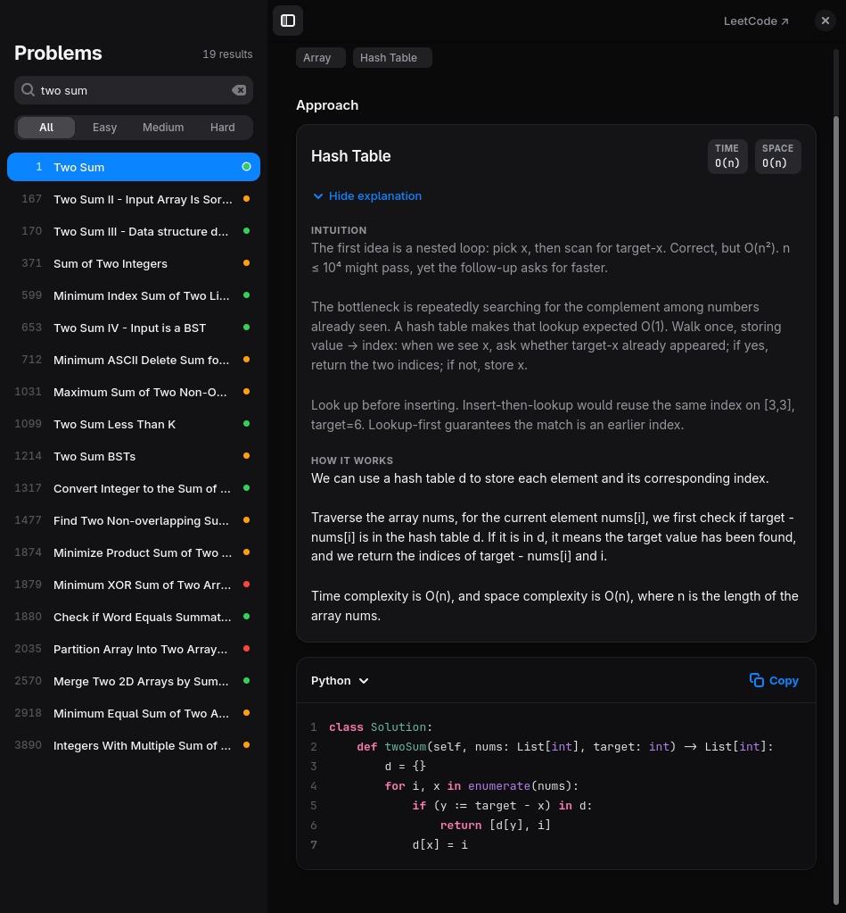

# lc-solutions

Type a LeetCode problem number, get its solution on your clipboard.

```console
$ lc 88
88. Merge Sorted Array [Easy] (py)
Solution copied to clipboard.
```

It comes in two forms that share the same code: a command-line tool (`lc`) and a
GTK 4 desktop app (`lc-gui`) that also shows the explanation, complexity and every
approach for the problem.

<p align="center">
  
</p>

## Features

- **Every problem.** Looks up all ~4,000 problems by number or by title (`lc two sum`).
- **16 languages.** Python, C++, Java, Go, JavaScript, TypeScript, Rust, C#, C, Kotlin,
  Swift, PHP, Ruby, Scala, SQL and Bash, as far as each problem has them.
- **Several approaches.** Problems with more than one solution (brute force, hash
  table, binary search, ...) let you pick which one to copy.
- **Database problems just work.** SQL-only problems return the SQL solution even if
  you asked for Python.
- **Works in the terminal or in a window.** The CLI needs nothing beyond Python.
- **Fast.** The problem list is cached locally, and the GUI only fetches the problem you open.

The GUI adds:

- The problem's difficulty, topic tags, time and space complexity, and a written
  intuition and explanation for each approach.
- Syntax highlighting, light and dark mode (it follows your system), and an Apple-style
  layout that collapses its sidebar in narrow windows.
- Opening a problem **copies the solution automatically**. The Copy button turns into
  "Copied" for a moment so you know it worked.

## Install

Requires Python 3 (developed on 3.14) and a clipboard tool. The GUI also needs GTK 4 and
libadwaita 1.6 or newer.

```sh
git clone https://github.com/ilqqy/lc-solutions.git
cd lc-solutions
./install.sh
```

This links `lc` and `lc-gui` into `~/.local/bin` and adds **LeetCode Solutions** to your
app menu. Nothing is copied, so `git pull` updates the installed commands. Remove it
again with `./install.sh --uninstall`.

<details>
<summary>Dependencies by distribution</summary>

| | CLI | GUI (adds) | Clipboard |
|---|---|---|---|
| Arch | `python` | `python-gobject gtk4 libadwaita gtksourceview5` | `wl-clipboard` or `xclip` |
| Fedora | `python3` | `python3-gobject gtk4 libadwaita gtksourceview5` | `wl-clipboard` or `xclip` |
| Debian / Ubuntu | `python3` | `python3-gi gir1.2-gtk-4.0 gir1.2-adw-1 gir1.2-gtksource-5` | `wl-clipboard` or `xclip` |

`gtksourceview5` is optional. Without it the GUI works but shows the code without colours.
On macOS, `pbcopy` is used for the clipboard, so the CLI should work, but only Linux
(Arch on Wayland) has been tested.

</details>

## Usage

### Command line

```sh
lc 88                # Python solution for problem 88
lc 88 -l cpp         # another language: py cpp java go js ts rs cs c kt swift php rb scala sql sh
lc 88 -s             # also print the solution
lc 3 -n 2            # the 2nd approach, when the problem has one
lc two sum           # search by title; a number is needed if several match
```

Set a default language once with `export LC_LANG=java` (fish: `set -Ux LC_LANG java`).
If a language or approach doesn't exist for a problem, the error tells you what does.

### Desktop app

Run `lc-gui`, or open **LeetCode Solutions** from your app menu.

| Key | Action |
|---|---|
| Just start typing | Search by number or title |
| `Ctrl` + `K` | Jump to the search field |
| `Enter` | Open the top result and copy its solution |
| `↓` | Move from the search field into the list |
| `Ctrl` + `Shift` + `C` | Copy again |
| `Esc` | Clear the search |

The segmented filter under the search box narrows the list to Easy, Medium or Hard.
Your chosen language is remembered between runs.

## How it works

The solutions are not stored in this repository. They are fetched on demand from the
open-source [doocs/leetcode](https://github.com/doocs/leetcode) collection:

1. `lc` downloads that project's problem index once and caches it for a week in
   `~/.cache/leetcode-solutions/`. Asking for a problem that isn't in the cache refreshes it.
2. The CLI downloads the one `Solution.<ext>` file you asked for.
   The GUI downloads the problem's README and splits it into approaches,
   explanations and per-language code.
3. The text goes to your clipboard through `wl-copy`, `xclip`, `xsel`, `pbcopy` or
   `clip.exe`, whichever is installed first. Unlike GTK's own clipboard, these
   keep the text after the program exits.

An internet connection is needed the first time you open each problem.

## Project layout

```
lc.py          the CLI, and the fetching/caching code the GUI reuses
lc_gui.py      the GTK 4 / libadwaita app
style.css      the app's look (colours, type, spacing)
styles/        syntax-highlighting colour schemes (light and dark)
install.sh     installs or removes the commands and app-menu entry
docs/          screenshots
```

## License

The code in this repository is released under the [MIT License](LICENSE). The solutions
it fetches are not part of it; see Credits below.

## Credits

All solutions and explanations come from
[doocs/leetcode](https://github.com/doocs/leetcode), which is licensed under
[CC BY-SA 4.0](https://creativecommons.org/licenses/by-sa/4.0/). This project only
fetches and displays them, so if you reuse or share what it copies, that license applies
to the solutions. Problem names belong to [LeetCode](https://leetcode.com). This project
is not affiliated with LeetCode or doocs.

Use it to learn from and check your work. Copying solutions into contests or interviews
defeats the point of the practice.
